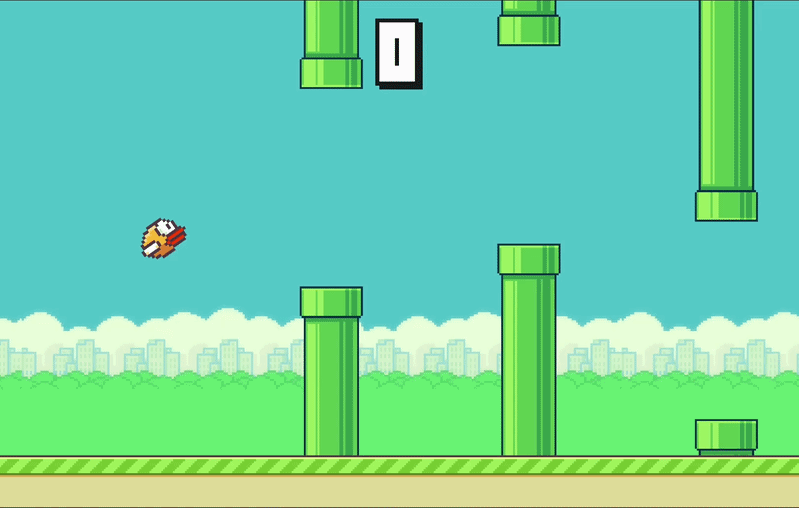

# Flappy Bird in Bevy

The web version of the game can be played here: [Github Pages](https://BigB132.github.io/first_rust_game/)

A simple flappy bird game made in Bevy. This is actually my first bevy/rust project, as i've just learnt the basics recently. I did follow a [tutorial](https://www.rustadventure.dev/flappy-bird) for this game, but modified it heavily.
This is my submission for the terra hackclub event (Prep Week #2).  

The assets are from [here](https://github.com/samuelcust/flappy-bird-assets)



## Building

Build the project by using
```
cargo build
```

Then run it using
```
cargo run
```

or build the executable using
```
cargo build --release
```
